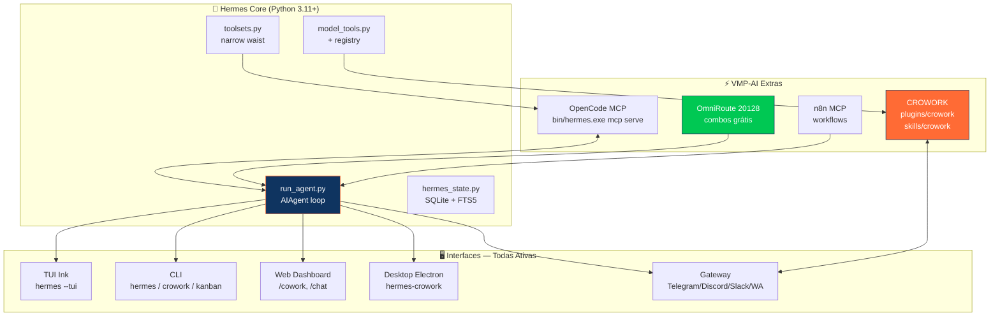
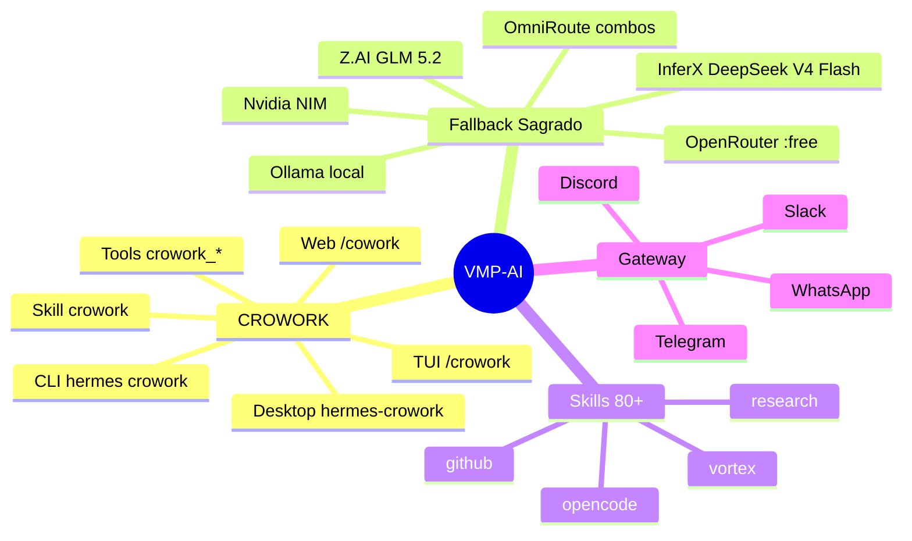
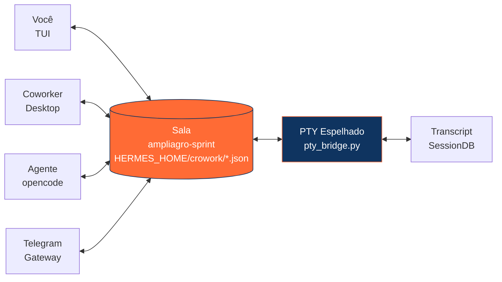
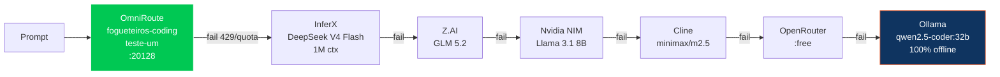

<div align="center">

[](https://git.io/typing-svg)

<p>
  <a href="LICENSE"></a>
  <a href="https://www.python.org/"></a>
  <a href="https://github.com/NousResearch/hermes-agent"></a>
  <a href="hermes-agent/skills/crowork/SKILL.md"></a>
  
  
</p>

<p>
  <br>
      
</p>

</div>

> **Agente de IA autônomo, local-first e pronto para produção.** Baseado no [Hermes Agent](https://github.com/NousResearch/hermes-agent) (Nous Research), com **CROWORK colaborativo**, **fallback inteligente com IAs grátis** (OmniRoute • InferX • Z.AI • Nvidia • Ollama) e fluxo **clone & use**.

---

## 🎨 Arquitetura Visual — VMP-AI





---

## 👥 CROWORK — Sala Colaborativa (nativo e permanente)

> **Uma sala = um transcript + um PTY espelhado + presença ao vivo.** Crie `ampliagro-sprint` e todos veem o mesmo chat e terminal.



**Todas as interfaces (já instaladas):**

| Interface | Comando | Arquivo |
|---|---|---|
| **CLI** | `hermes crowork create/join/list/status/share` (aliases `crow`, `cw`) | `hermes_cli/crowork.py` |
| **TUI** | `/crowork create sala-01` | `hermes_cli/commands.py` |
| **Web** | `/cowork` → Cowork Board | `web/src/pages/CoworkPage.tsx` |
| **Desktop** | painel `hermes-crowork` | `apps/desktop/src/plugins/hermes-crowork/` |
| **Tools** | `crowork_create`, `crowork_join`, ... | `plugins/crowork/` |
| **Skill** | `crowork` | `skills/crowork/SKILL.md` |

**Auto-start:** `Iniciar.ps1` + `Abrir-Hermes.bat` + `Abrir-Hermes-TUI.bat` criam/entram em `ampliagro-sprint` automaticamente. Dados em `HERMES_HOME/crowork/`.

---

## ⚡ Fallback Inteligente — IAs Grátis (Robson Vibe Coding)



**Vídeos que viraram código (canal Robson Oliveira — Vibe Coding):**

| Vídeo | O que virou `config.yaml` |
|---|---|
| `6pEmC9aAkQU` Hermes + OmniRoute | `providers.omniroute → 20128/v1`, combos `fogueteiros-coding` |
| `SciHyoqtUmk` DeepSeek V4 Flash InferX | `providers.inferx → api.inferx.net/v1` |
| `1QH-cKRuyuM` GLM 5.2 Z.AI | `providers.zai → api.z.ai/paas/v4` |
| `bOuC3RHpBak` Nvidia NIM grátis | `providers.nvidia → integrate.api.nvidia.com/v1` |

> Nunca trava em `429/402/quota` — troca e avisa: *“Modelo X esgotou, trocando para Y”*.

---

## 🧱 Estrutura do repositório

```
VMP-AI/
├─ hermes-agent/          # código-fonte do Hermes Agent (upstream, MIT)
│  ├─ skills/             # 16 categorias, 80+ skills (vortex, github, opencode...)
│  ├─ plugins/crowork/    # ★ CROWORK (6 tools)
│  └─ opencode.jsonc      # config opencode upstream (usa ../bin/hermes.exe)
├─ .opencode/
│  └─ skills/vortex-hermes/ # BRIDGE VMP-AI: opencode + Hermes (este repo)
├─ proton/                # PROTON — JARVIS app (RTX + neon + fluid, index.html)
├─ crowork/               # ★ salas compartilhadas (ampliagro-sprint.json)
├─ config.yaml            # fallback inteligente (OmniRoute → InferX → Z.AI → Ollama)
├─ opencode.jsonc         # CONFIG PRINCIPAL — Hermes MCP + omniroute/inferx/zai/nvidia + crowork
├─ setup.bat / setup.ps1  # instalador 1-clique (valida 10 checks)
├─ Iniciar.ps1            # launcher interativo + Ensure-Crowork
├─ Abrir-Hermes.bat       # CLI + auto CROWORK
├─ Abrir-Hermes-TUI.bat   # TUI + auto CROWORK
├─ Abrir-OpenCode.bat     # OpenCode na raiz + CROWORK
└─ SOUL.md                # persona + CROWORK nativo
```

> 🔒 **Privacy-first:** segredos, sessões, memórias, bancos de dados e caches **não** são versionados (veja `.gitignore`).

---

## ✅ Pré-requisitos

- Windows 10/11 com **PowerShell 5.1+** (nativo) — ou WSL2/Linux
- Conexão na **primeira execução** (para baixar Python, `uv` e dependências)
- (Opcional, para OpenCode) **Node.js + npm**

---

## 🚀 Instalação — *clone & use*

**Opção A — Duplo-clique (recomendado):**
```powershell
git clone https://github.com/luck-of-luck/VMP-AI.git
cd VMP-AI
# Duplo-clique em setup.bat  (ou: powershell -ExecutionPolicy Bypass -File setup.ps1)
# Edite .env e preencha PELO MENOS UMA: OMNIROUTE_API_KEY, INFERX_API_KEY, CLINE_API_KEY ou OPENROUTER_API_KEY
# 100% offline: instale Ollama (https://ollama.com) e pule chave
# Pronto! Abrir-Hermes.bat  (já entra em crowork/ampliagro-sprint)
```

**Opção B — Terminal:**
```powershell
git clone https://github.com/luck-of-luck/VMP-AI.git
cd VMP-AI
powershell -ExecutionPolicy Bypass -File .\setup.ps1
notepad .env
.\Abrir-Hermes.bat
```

| Etapa | O que faz |
|-------|-----------|
| 1 | Valida / instala **Python 3.11–3.13** |
| 2 | Instala **uv** (Astral) |
| 3 | `uv sync` + gera `bin\` (hermes, hermes-acp) |
| 4 | Cria `.env` + wizard de chaves |
| 5 | Verifica **Node/opencode** e **Ollama/LM Studio** (grátis) |
| 6 | **CROWORK** — cria `crowork/ampliagro-sprint.json` |

> `setup.bat -Extras "messaging,mcp"` / `setup.ps1 -WithN8nMCP`.

---

## 🖥️ Primeiros passos (com CROWORK)

```powershell
# CLI já no crowork
.\Abrir-Hermes.bat
/crowork status ampliagro-sprint
/crowork share ampliagro-sprint  # envia no WhatsApp

# TUI
.\Abrir-Hermes-TUI.bat  # já faz crowork join ampliagro-sprint

# Launcher interativo
powershell -File Iniciar.ps1  # 1) OpenCode RAIZ (já com crowork)
```

### OpenCode + Hermes — editor IA com skills e MCP

```powershell
npm install -g opencode-ai
opencode                     # TUI (ou: Abrir-OpenCode.bat)
opencode mcp list            # hermes ✓ connected
```

**`opencode.jsonc` já vem com:**
- **MCP `hermes`** (`bin/hermes.exe mcp serve`) — 80+ skills + `crowork_*`
- **Providers:** `omniroute`, `inferx`, `zai`, `nvidia`, `cline`, `openrouter`, `ollama-local`, `lmstudio-local`
- **Instructions:** `SOUL.md` + `hermes-agent/AGENTS.md` + `skills/crowork/SKILL.md`

---

## 🧠 Esquema inteligente + visão de tela

- **Modelo principal:** **OmniRoute combo** → **InferX DeepSeek V4 Flash** → **MiniMax M2.5 via Cline** (1M ctx)
- **Leitura de tela:** `auxiliary.vision` via `cline/openai/gpt-4o` → `browser_vision`
- **Contextos enormes:** `context_file_max_chars: 400k`, `tool_output: 150k`

## 🔌 Todas as IAs do seu PC (fallback)

| Ordem | IA | Chave |
|------|-----|-----------|
| 1-2 | **OmniRoute combos** (`fogueteiros-coding`, `teste-um`) | `OMNIROUTE_API_KEY` |
| 3 | **InferX DeepSeek V4 Flash** (1M) | `INFERX_API_KEY` |
| 4 | **Z.AI GLM 5.2** | `ZAI_API_KEY` |
| 5 | **Nvidia NIM** (Llama/GLM) | `NVIDIA_API_KEY` |
| 6-8 | **Cline** (minimax/deepseek/ClinePass) | `CLINE_API_KEY` |
| 9 | **Copilot** (gpt-4.1) | `GH_TOKEN` |
| 10-11 | **Claude / Kimi** | `ANTHROPIC_API_KEY` / `KIMI_API_KEY` |
| 12-15 | **OpenRouter :free** (auto-router) | `OPENROUTER_API_KEY` |
| 16 | **LM Studio** `:1234` | app local |
| 17-20 | **Ollama** `qwen2.5-coder:32b` | `ollama serve` (offline) |

```bash
# Delegar para outros CLIs:
claude -p "implemente X"
opencode run "implemente X"
# ou dentro do crowork:
hermes crowork share ampliagro-sprint
```

---

## ⚙️ Configuração

| Arquivo | Finalidade |
|---------|-----------|
| `.env` | Chaves API (`OMNIROUTE`, `INFERX`, `ZAI`, `NVIDIA`, `CLINE`, `OPENROUTER`...) |
| `config.yaml` | Modelos + fallback + memória + crowork |
| `opencode.jsonc` | MCP Hermes ↔ OpenCode + providers espelhados |
| `SOUL.md` | Persona + CROWORK nativo e permanente |
| `crowork/*.json` | Salas compartilhadas (`ampliagro-sprint.json`) |

---

## 🧭 Comandos úteis

| Comando | Ação |
|---------|------|
| `hermes crowork create <sala> [tópico]` | Cria sala (aliases `crow`, `cw`) |
| `hermes crowork join <sala>` | Entra (espelha transcript/PTY) |
| `hermes crowork list/status/share` | Gerencia salas |
| `/crowork` | No chat TUI |
| `/cowork` | No Web Dashboard |
| `hermes --tui` | TUI completa |
| `omniroute serve` | Inicia router local (20128) |
| `hermes mcp serve` | Servidor MCP |
| `hermes gateway setup` | Telegram/Discord/WA |

---

## 🔐 Privacidade & segurança

- `.gitignore` robusto: `.env`, `auth.json`, `crowork/*.json` privados **não** entram no Git (salas são locais por `HERMES_HOME`).
- Roda **localmente** — você controla chaves e dados.
- Aprovação `smart` para comandos destrutivos.

---

## 📊 Stack Visual

<div align="center">

<br>
  
</div>

---

## 🛟 Solução de problemas

- **Antivírus acusa `uv.exe`:** falso positivo (Rust Astral). Exclua `bin\`.
- **`hermes` não reconhecido:** `setup.bat` ou `hermes-agent\venv\Scripts\hermes.exe`.
- **`setup.bat` pisca:** `powershell -ExecutionPolicy Bypass -File setup.ps1`.
- **OmniRoute não conecta:** `omniroute serve --daemon` + cheque `http://localhost:20128`, `OMNIROUTE_API_KEY` em `.env`.
- **CROWORK não aparece:** `hermes tools list | findstr crowork` → deve estar `✓ enabled`. Reinicie Hermes após editar `toolsets.py`.
- **Sem chave API?** `ollama pull qwen2.5-coder:32b` → 100% offline.

---

## 📜 Licença & créditos

- Este repo: **MIT** © 2026 VMP-AI ([LICENSE](LICENSE)).
- `hermes-agent/`: **MIT** © Nous Research — [repositório oficial](https://github.com/NousResearch/hermes-agent).


