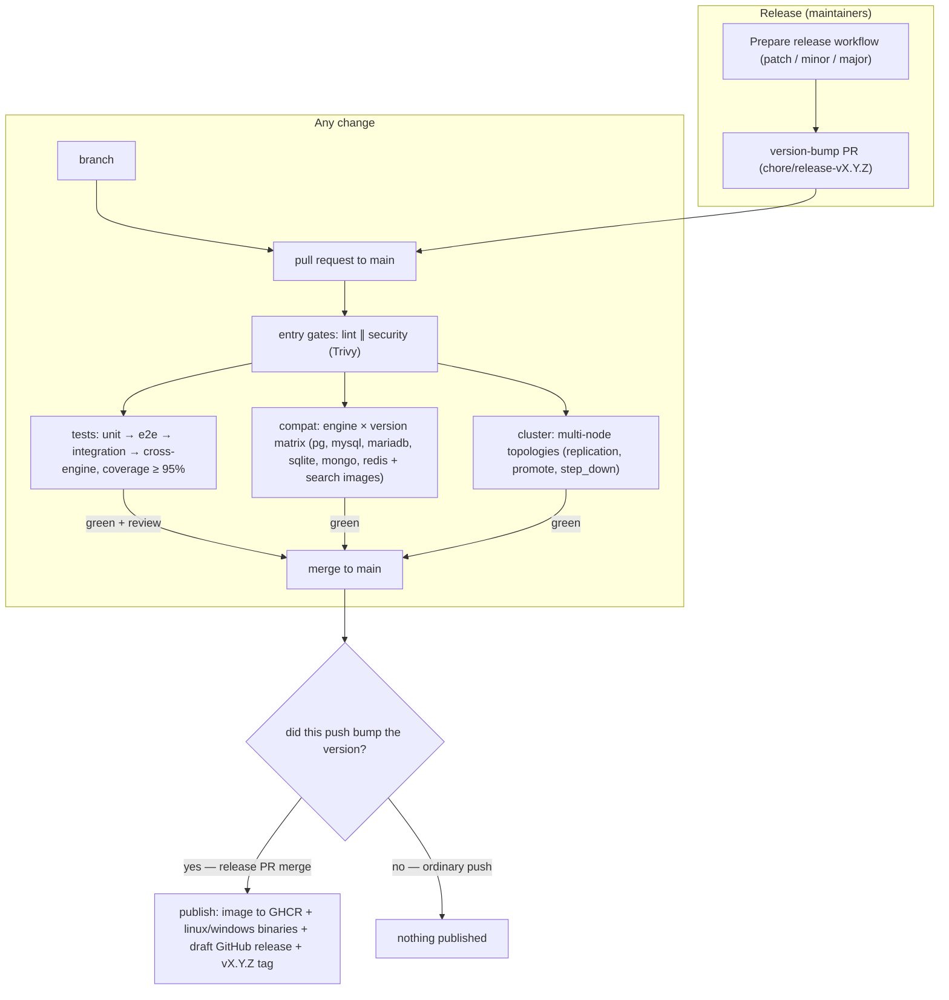

# Contributing

Thanks for your interest in improving mcp-database — a multi-database MCP server (PostgreSQL, MySQL, MariaDB, SQLite, MongoDB, Redis) over stdio.

## Table of Contents

- [Documentation map](#documentation-map)
- [Prerequisites](#prerequisites)
- [Setup](#setup)
- [Development loop](#development-loop)
- [Testing rules](#testing-rules)
- [Contribution flow](#contribution-flow)
- [Pull requests](#pull-requests)
- [Releases (maintainers)](#releases-maintainers)
- [Security](#security)

## Documentation map

Read before contributing; update the matching doc in the same PR as your change:

| Doc | Covers |
|-----|--------|
| [docs/architecture.md](docs/architecture.md) | Design decisions, component map, request flow, failure modes, runbook |
| [docs/development.md](docs/development.md) | Commands, playground, CI pipeline, agent evals |
| [docs/tools.md](docs/tools.md) | The 39 tools with parameters and per-engine support |
| [docs/configuration.md](docs/configuration.md) | Every environment variable and access-mode refinement |
| [docs/connections.md](docs/connections.md) | Per-engine connection examples, local and external |
| [docs/docker.md](docs/docker.md) | Running the published GHCR image |
| [docs/evals/README.md](docs/evals/README.md) | Agent evaluations: question files and the claude CLI runner |
| [scripts/README.md](scripts/README.md) | Standalone dev/build scripts |

## Prerequisites

- Python 3.12
- [uv](https://docs.astral.sh/uv/)
- Docker (only for integration tests and the playground databases)
- make

## Setup

```bash
make install            # uv sync
make up && make mongo-rs && make seed   # optional: playground databases with deterministic data
```

## Development loop

```bash
make lint               # ruff check + format check (must pass clean)
make fmt                # autofix + reformat
make test-unit          # fast: unit + e2e, no Docker
make test-integration   # real databases via testcontainers (requires Docker)
make test               # full suite; coverage gate: fail under 95%; HTML report in temp/reports/coverage/
make evals              # optional: agent evals via the claude CLI (one-shot playground; reports in temp/reports/)
uv run pytest tests/unit/test_guard_sql.py -k name   # single test
```

CI runs on every push and PR via the read-only **test** workflow: two parallel entry gates — **lint** (ruff) and **security** (Trivy: dependency vulns, secrets, misconfig) — then three parallel jobs: **tests** (unit → e2e → integration → cross-engine in one job, accumulating coverage and enforcing the 95% gate), **compat** (engine×version matrix: PostgreSQL 16/17, MySQL 8.0/8.4, MariaDB 10.11/11.4, SQLite, MongoDB 7/8, Redis 7/8, plus pgvector and Atlas-local images, no coverage) and **cluster** (multi-node topologies — replication, promote, step_down — no coverage). All jobs must pass before merge; agent evals stay local and are not a CI gate. The **release** workflow (the only one with write access) does not re-run the gates — it relies on the gates that already ran on the release PR and on the merge push via **test**.

## Testing rules

- Every behavior needs **happy, sad and absurd** cases (empty/negative/huge/unicode/injection inputs must produce a clear error, never a crash).
- Every tool must be in the e2e matrix (`VALID_ARGS` in `tests/e2e/test_tools_contract.py`).
- New tools must follow the name prefix semantics (`db_schema_`/`db_read_`/`db_perf_` never write; `db_write_`/`db_admin_` are destructive and audited) and declare MCP annotations.
- Do not weaken the security invariants (fail-closed validation, mode matrix, unbounded-mutation guard, password redaction) — see `CLAUDE.md` for the full list.
- Update the matching doc in the same PR (see the [documentation map](#documentation-map)) — e.g. `docs/tools.md` for tool behavior, `docs/architecture.md` for flow or security mechanisms, `docs/evals/` when seeds change answers.

## Contribution flow



## Pull requests

- Target `main`; keep PRs focused.
- Use [Conventional Commits](https://www.conventionalcommits.org/) (`feat:`, `fix:`, `docs:`, `ci:`, `chore:`).
- All repo artifacts (code, comments, docs, examples) in English.
- Changes under `.github/` require owner review (CODEOWNERS).
- Do not bump the project version — releases are maintainer-only, via the "Prepare release" workflow.

## Releases (maintainers)

Publishing fires **only on the push that bumps the version** — i.e. merging the release PR. An ordinary push or PR that does not change the version runs the tests but never publishes.

1. Run the **Prepare release** workflow (Actions → Prepare release → patch/minor/major) — it opens a version-bump PR.
2. Review and merge the PR.

Merging it triggers the publish jobs (the gates already ran on the PR and on the merge push): the multi-arch Docker image to GHCR (`X.Y.Z`, `sha`, `latest`), the standalone Linux/Windows binaries, the `vX.Y.Z` tag, and a draft GitHub release with the SBOM, the binaries and a commit-log changelog since the previous tag — for the maintainer to review and publish.

## Security

To report a vulnerability, follow [SECURITY.md](SECURITY.md) — do not open a public issue.
