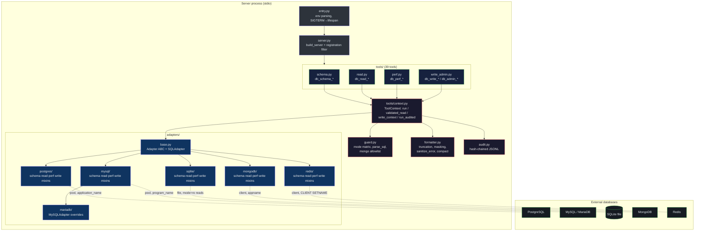
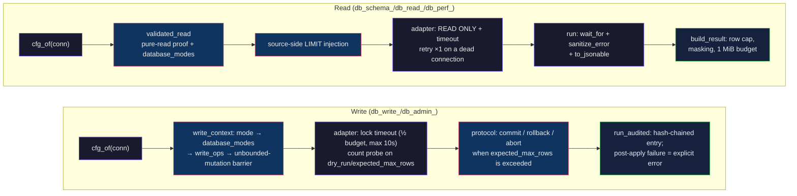

# Architecture: mcp-database

Multi-database MCP server over stdio, on FastMCP. The caller is an LLM agent: input is untrusted
by default, errors teach without leaking data, and writes are authorized, bounded and audited
before touching the database.

## Table of Contents

- [Design decisions](#design-decisions)
- [Component map](#component-map)
  - [Layer responsibilities](#layer-responsibilities)
- [Request flow](#request-flow)
- [Failure modes and mitigations](#failure-modes-and-mitigations)
- [Operational runbook](#operational-runbook)
  - [Starting a server](#starting-a-server)
  - [Restricting the tool surface](#restricting-the-tool-surface)
  - [Verifying the audit log](#verifying-the-audit-log)
  - [Common errors](#common-errors)

## Design decisions

| Decision | How it works | Where |
|----------|--------------|-------|
| One connection per instance, env-only | `URI` is the only required variable; no CLI. Multiple databases = multiple MCP entries. `PASSWORD_ENV` injects the password and keeps secrets out of the URI | `connection_from_env` |
| Risk class in the tool name | Prefixes `db_schema_`/`db_read_`/`db_perf_`/`db_write_`/`db_admin_` × modes: `read_write` allows all, `read_only` allows schema/read/perf, `monitor` allows schema/perf. `database_modes` refines per database; a query naming no database uses the most restrictive mode | `guard.MODE_ALLOWS`, `ConnectionConfig.mode_for` |
| Fail-closed SQL validation | Exactly one statement, unparseable SQL rejected, the `/*!` marker rejected on every engine. Reads are proven pure, with no embedded writes | `guard.parse_sql`, `guard.validate_sql_read` |
| MongoDB: allowlist + JS sweep | Operations come from an allowlist; the whole query is swept for `$where`/`$function`/`$accumulator` and `$out`/`$merge`, `find` filters included | `guard.validate_mongo_read`, `mongo_query.scan_for_forbidden_operators` |
| Shape auditing with a hash chain | `db_write_`/`db_admin_`/export calls become JSONL with literals replaced by `?`; each entry carries the sha256 of the previous one and `verify_chain` finds the first broken link | `AuditLogger`, `audit.verify_chain` |
| Dry run via count probe | A simple literal UPDATE/DELETE uses `SELECT count(*)` instead of execute-and-rollback, which would still pay dead tuples and WAL; `expected_max_rows` also holds on the real execution | `SQLAdapter._estimate_affected` |
| Capabilities declared, not probed | Each adapter declares its features, surfaced by `db_schema_connections`; a missing feature raises `GuidanceError` with the enabling command | `Adapter.CAPABILITIES` |
| Exposure orthogonal to access mode | `TOOLS`/`DISABLE_TOOLS` (mutually exclusive) resolve against the canonical inventory; an unlisted tool is never registered: invisible, not denied | `resolve_enabled_tools`, `build_server` |
| Redis: allowlisted envelope, banned core | Queries are `{"command", "args"}` against read/write allowlists; `FLUSH*`/`EVAL`/`SCRIPT`/`FUNCTION`/`KEYS`/`CONFIG` (set)/`DEBUG`/`SHUTDOWN`/`MONITOR`/`MIGRATE`/`SWAPDB` are rejected in every mode; audit keeps key names only | `redis_query`, `guard.validate_redis_read` |
| SQLite: structurally read-only reads | Reads open the file with the `mode=ro` URI — a read cannot write even past validation; writes get `busy_timeout` (the lock-timeout analog) | `SQLiteAdapter._fetch_once` |

## Component map



Every outbound connection identifies itself as `mcp-database/<conn>` (`application_name` /
`program_name` / `appname`); the tool's own sessions are visible in `pg_stat_activity`, the
processlist and `$currentOp`.

### Layer responsibilities

| Layer | File(s) | Responsibility |
|-------|---------|----------------|
| Entry | `src/mcp_database/entry.py` | Env parsing, log setup, SIGTERM→Ctrl-C, exit 2 on config errors |
| Server | `src/mcp_database/server.py` | Assembles FastMCP, registers tools, lifespan that closes the pools |
| Tools | `src/mcp_database/tools/*.py` | Thin MCP-facing functions; each module exposes `register(mcp, ctx)` |
| Context | `src/mcp_database/tools/context.py` | Registry, lazy adapters, timeout, validation and audit orchestration |
| Guard | `src/mcp_database/guard.py` | All authorization and query validation; fail-closed |
| Adapters | `src/mcp_database/adapters/` | Per-engine execution behind one ABC; declared capabilities |
| Formatter | `src/mcp_database/formatter.py` | Truncation, masking, error sanitization, JSON conversion |
| Audit | `src/mcp_database/audit.py` | Hash-chained JSONL log of destructive calls and exports |

## Request flow



- Reads retry at most once (`SQLAdapter._fetch`) and only when the connection died; writes never retry.
- `compact` folds rows into `{columns, rows: [[...]]}` after masking, so redaction still applies (`build_result`).
- Planner statistics get their own masking (`mask_column_stats`): MCVs and histograms carry real values.

## Failure modes and mitigations

| Failure | Behavior | Where |
|---------|----------|-------|
| Unparseable or multi-statement SQL | Rejected before touching the database (fail-closed) | `guard.parse_sql` |
| Write hidden in `/*!` | Rejected on every engine at the parse choke point | `guard.parse_sql` |
| `UPDATE`/`DELETE` with no `WHERE` (or `*Many` with an empty filter) | Rejected without `dry_run`/`expected_max_rows` | `ToolContext.write_context` |
| Query exceeds the time budget | Server-side timeout (`statement_timeout`/`max_execution_time`/`maxTimeMS`) and a client-side `wait_for` backstop | adapters, `ToolContext.run` |
| Connection dies mid-read | One retry on a fresh connection, reads only | `SQLAdapter._fetch` |
| Cancelled MySQL write | Connection closed: the server aborts the statement and it never returns to the pool | `MySQLAdapter.write` |
| Blocked DDL | Lock timeout (½ budget, max 10s) fails fast | `PostgresAdapter`, `MySQLAdapter` |
| Driver error echoes values | `sanitize_error` strips URI passwords and echoed values before the agent and the audit log | `formatter.sanitize_error` |
| Result too large | Row cap, 1 MiB budget and a truncation note; the first row always survives | `formatter.build_result` |
| Audit fails after an applied write | Explicit "applied, but audit logging failed" error; never silent | `ToolContext.run_audited` |
| Audit log tampered with | The hash chain breaks; `verify_chain` reports the first invalid index | `audit.verify_chain` |
| Feature missing on the engine | `GuidanceError` with the enabling command | `GuidanceError` |
| `kill`/`docker stop` of the server | SIGTERM takes the Ctrl-C path: the lifespan runs `close_all` and the pools close cleanly | `entry.main`, `build_server` |
| Mongo `step_down` drops the connection | `AutoReconnect` is the success path | `MongoAdapter.cluster_action` |

## Operational runbook

### Starting a server

```json
{
  "mcpServers": {
    "orders-db": {
      "command": "uvx",
      "args": ["mcp-database"],
      "env": {
        "URI": "postgresql://app@db.internal:5432/orders",
        "MODE": "read_only",
        "PASSWORD_ENV": "ORDERS_DB_PASSWORD",
        "AUDIT_LOG": "/var/log/mcp-database/orders-audit.log"
      }
    }
  }
}
```

- `URI` is the only required variable; `NAME` defaults to the engine type.
- Invalid config: exit 2 and a `mcp-database:` message on stderr.
- Full reference: `docs/configuration.md`; examples: `docs/examples/mcp.json`.

### Restricting the tool surface

- Exactly one of `TOOLS` (allowlist) and `DISABLE_TOOLS` (denylist), a JSON array of names.
- Unknown names and empty exposures are rejected at startup (`resolve_enabled_tools`).
- Controls registration: a hidden tool never appears to the MCP client.

### Verifying the audit log

```bash
uv run python -c "from pathlib import Path; from mcp_database.audit import verify_chain; \
print(verify_chain(Path('~/.local/state/mcp-database/audit.log').expanduser()))"
```

- `None` = intact chain; an integer = index of the first entry with a broken `prev` link.
- Default path: `~/.local/state/mcp-database/audit.log`, created with `0600`.
- Rotation (`AUDIT_MAX_BYTES`): the previous chain stays in `audit.log.1`; the new file restarts from scratch.

### Common errors

| Message | Meaning | Action |
|---------|---------|--------|
| `URI is required (e.g. URI=postgresql://...)` | No `URI` in the env block | Add `URI` |
| `Unknown connection '...'` | A `conn` this instance does not serve | The message lists the configured names |
| `Connection '...' is 'read_only': db_write_* tools are not allowed ...` | Mode matrix denial | Expected on read-only setups; raise `MODE` only deliberately |
| `... applied, but audit logging failed` | The write happened; its audit entry did not | Fix the audit log path/permissions and reconcile |
| `hypopg is not installed. Run: CREATE EXTENSION hypopg; ...` | Feature missing on the target | Run the given command or skip the feature |
| `Operation on '...' exceeded Ns and was cancelled` | Client-side timeout backstop | Narrow the query or raise `TIMEOUT` |
