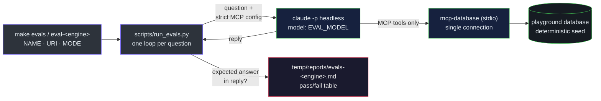

# Development

## Table of Contents

- [Commands](#commands)
- [CI](#ci)
- [Testing](#testing)
  - [Agent evals](#agent-evals)

## Commands

```bash
make install            # uv sync
make lint               # ruff check (incl. bandit S rules) + format check
make fmt                # autofix + reformat
make test-unit          # fast tests (unit + e2e), no Docker
make test-integration   # real databases via testcontainers (requires Docker)
make test-cluster       # multi-node topologies: replication, promote, step_down (requires Docker)
make test               # full suite with the 95% coverage gate; HTML report in temp/reports/coverage/
make up && make mongo-rs && make seed  # playground databases (pgvector-enabled PostgreSQL) + deterministic data
                                       #   host ports: pg 5432, mysql 3306, mariadb 3307, mongo 27019 (use ?directConnection=true),
                                       #   redis 6380, atlas 27018; sqlite seeds into temp/playground.db
make atlas-local && make atlas-seed    # optional: mongodb-atlas-local for $search/$vectorSearch
make evals              # agent evals via the claude CLI, reports in temp/reports/
make down               # stop and remove the playground databases
make bin                # standalone binary at dist/mcp-database (no Python needed to run)
```

`make bin` uses PyInstaller: the ~32 MB executable bundles Python and all drivers, so target machines need neither Python nor uv. Binaries are per-OS and per-architecture; build on the platform you target (Mac users: run `make bin` on the Mac, or use the Docker image).

## CI

The CI is split across two workflows. **`test.yml`** is the read-only gate suite, running on every push to main and every PR (including forks) with no write access to anything: static analysis (ruff lint/format/bandit) and security scan (Trivy) in parallel, then the merged **tests** job (3) runs unit → e2e → integration → cross-engine in steps, accumulating coverage in place (`--cov-append`, no artifacts) and enforcing the 95% gate; a parallel **compat** matrix (4) smoke-tests each engine×version (PostgreSQL 16/17, MySQL 8.0/8.4, MariaDB 10.11/11.4, SQLite, MongoDB 7/8, Redis 7/8, plus pgvector and Atlas-local) with `--no-cov`; a parallel **cluster** job (5) runs the multi-node topology tests (`-m cluster`, `--no-cov`) — pg primary+standby, mysql source+replica, mongo 3-member replica set, redis primary+replica — kept out of the coverage gate so orchestration flakiness never blocks it. Cheap failures stop the pipeline before the Docker-heavy stages. Each job writes a `$GITHUB_STEP_SUMMARY` section (ruff/Trivy reports, version, per-tier coverage table). **`release.yml`** is the only workflow with write access: on a push to main it detects a release (`is_release`: the `pyproject.toml` version changed in this push and has no matching tag), and if so publishes — `docker` (multi-arch image to GHCR), `binaries` (linux/windows x86_64) and `release` (creates the `vX.Y.Z` tag and a draft GitHub release with the SBOM, the binaries and a commit-log changelog). It does not re-run the gates: they already ran on the release PR (branch protection) and on this same push via `test.yml`. An ordinary push never publishes. The maintainer flow: run `prepare-release` → review and merge the version-bump PR → the merge publishes.

## Testing

Every behavior is tested with happy and sad paths, including absurd inputs (empty queries, negative limits, embedded `; DROP TABLE`, emoji identifiers). Integration tests run against real PostgreSQL, MySQL, MariaDB, MongoDB and Redis containers via testcontainers (SQLite runs on a real file); `test_tls_integration.py` additionally boots TLS-enabled PostgreSQL, MongoDB and Redis containers so `db_perf_tls` is validated end to end against real served certificates. `make test-cluster` additionally builds real multi-node topologies over a private docker network (`tests/integration/cluster_topologies.py` — pg primary+standby, mysql and mariadb source+replica, mongo 3-member replica set, redis primary+replica) and exercises the replication views, `db_perf_cluster` findings and `db_admin_cluster` actions under real failures: promote after a primary crash, step_down re-election, quorum loss, a broken SQL replica, paused WAL replay, and access modes enforced on a live replica. Full tool reference and per-engine support: [tools.md](tools.md).

### Agent evals

A fourth validation layer lives in [evals/](evals/): verified question/answer pairs per engine — including vector and text search against pgvector, MySQL FULLTEXT and the Atlas-local playground. Each question is answered by a fresh headless `claude -p` session that has only the mcp-database stdio server attached, so the run measures whether an agent can find the answer through the MCP surface alone.



```bash
make evals                             # one-shot: playground up + seeded + all engines; reports in temp/reports/
make eval-postgres                     # single engine (also: eval-mysql, eval-mariadb, eval-sqlite, eval-mongodb, eval-redis, eval-atlas);
                                       #   assumes the playground is already up and seeded
make evals EVAL_MODEL=opus             # override the model alias (default: sonnet)
```

The only requirement is a logged-in [claude CLI](https://docs.anthropic.com/en/docs/claude-code) — the runner never calls the Anthropic API directly, so no `ANTHROPIC_API_KEY` is involved and usage comes out of the CLI subscription. Evals run locally and on demand, never in CI: the pipeline has no authenticated CLI session, and an LLM answer is not a deterministic pass/fail gate.
